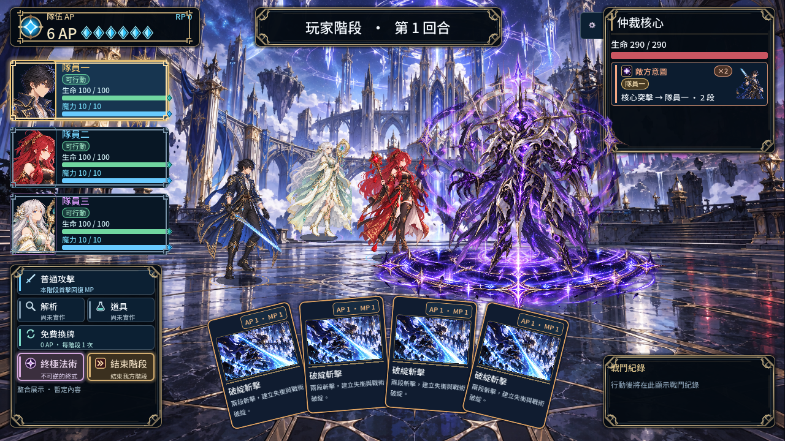

# Astriom Boss 參考圖調整驗證

實作提交：`da325e3`。需求來源：使用者於 2026-10-17 提供的三層組合參考與動畫參數。範圍僅為 Boss 呈現，沿用 Node2D／Compatibility，未改 Domain。

| 需求（USER_APPROVED） | 實作 | 驗證 |
|---|---|---|
| 腳下召喚陣、背後光環、可讀主體 | MagicCircle → AuraBack → Body，根節點橢圓陰影 alpha 0.35 | GUI 三層皆可辨識 |
| 主體微浮動 | 10 px、2.4 秒 | AnimationPlayer + GUI |
| 光環呼吸 | 基準縮放的 0.96～1.04、alpha 0.75～1.0 | AnimationPlayer + GUI |
| 法陣慢轉與微脈動 | 每秒 7.5°，alpha 0.82～0.94 | BA-14、0°／30°／45°／60° GUI |
| 受擊、擊敗 | 閃白、水平微抖動，Body/Aura/Circle 淡出 | BA-08～12 |

法陣保留原 PNG；shader 取其下半部，以 UV 旋轉並加入 1.45 倍透明邊界。Sprite 的扁平外框固定，避免直接旋轉 Sprite 造成地面翻立或斜角裁切。使用普通混色；本輪未採 ADD，也未執行完整效能 profile，不宣稱 FPS 或 GPU budget 達標。這是固定戰場的 2D 透視演出，不是幾何 3D 模型。

## 實際結果

Windows、Godot `4.7.2.stable.official.ed1daf0bf`、1280×720、OpenGL 3.3 Compatibility、NVIDIA GTX 1650／driver 555.99。

- [Headless 原始報告](evidence/boss_astriom_reference_20261017/headless.log)：14/14 PASS，退出碼 0。
- [GUI 原始報告](evidence/boss_astriom_reference_20261017/gui.log)：15/15 PASS，退出碼 0；真實 GPU 編譯 shader 並渲染。
- [既有 VFX 回歸報告](evidence/boss_astriom_reference_20261017/spell_visual.log)：46/46 PASS，退出碼 0。
- [初次 headless 失敗](evidence/boss_astriom_reference_20261017/initial_headless_failure.log)：headless backend 無法取得未顯式設定的 shader uniform 預設值，造成 `float(null)`；已於 `_fit_layers()` 顯式初始化 angle，修正後重跑通過。
- `git diff --check` 通過。獨立 code review 完成；旋轉邊界依反向 UV 映射推導核對，45° 真實畫面無矩形裁切。

這些證據涵蓋場景 API、自動呈現與人工目視截圖；未宣稱真人完整 Boss 一戰驗收或 GitHub CI PASS。低成本模型獨立驗收仍由 handoff 路由。
